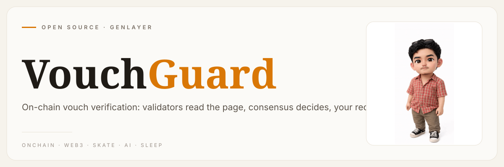
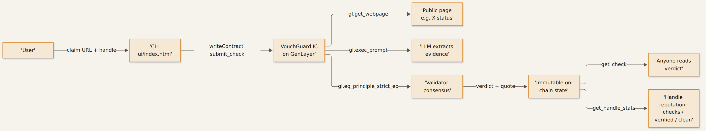

**[urelkdubdqwr](https://github.com/urelkdubdqwr)** · [studiopinggirkasur.xyz](https://studiopinggirkasur.xyz/)

**Vouches you can't fake — two strangers, one bond, settled by consensus instead of vibes.**

## What it is

VouchGuard is a GenLayer Intelligent Contract that verifies public endorsements on-chain. You hand it a claim URL (a public page that supposedly contains a vouch, e.g. an X status) plus the handle that supposedly wrote it. Validators fetch the page, an LLM pulls out the sentence that proves it, and the result is agreed through GenLayer's equivalence principle.

The verdict lands in contract state as immutable history: no screenshots to edit, no trust-me-bro, no moderator deciding what is real. Anyone can read it back forever, and every checked handle accumulates an on-chain reputation.

## How it works



- `submit_check(url, handle)` — one write, keyed by **(normalized URL, handle)**.
  The same page can be checked against different handles independently, and a
  check that came back `not_found` / `author_mismatch` / `unverifiable` can be
  retried (each attempt is counted). Only a **`verified` verdict is final** —
  so a first caller can never permanently bind a page to the wrong handle.
- **Platform syndication path (fetchable authorship).** The `x.com` HTML page
  itself 403s datacenter runners, so verified authorship also comes from the
  platform's own syndication CDN: submit
  `https://cdn.syndication.twimg.com/tweet-result?id=<tweet>&lang=en&token=x`
  as the claim URL. The tweet JSON is served by twitter's own infrastructure,
  and a verified result requires the payload's `user.screen_name` to equal the
  claimed handle, the tweet `id` in the URL to pin the payload's `id_str`
  (the claim cannot be swapped onto another post), and the quote to be verbatim
  in the payload text.
- **A refused fetch is evidence, never a verdict.** If the platform blocks the
  fetch (HTTP 403 from runner IP ranges, dead URL), the check is stored as a
  retryable `unverifiable` with the failure reason in its `note` — nothing is
  fabricated from a page nobody could read, and nothing crashes.
- **Verified requires AUTHENTICATED authorship, from three conditions (all of
  them, no exceptions):**
  1. the claim page must live on the X/Twitter platform itself (`x.com` /
     `twitter.com`). A self-declared author in the metadata of an arbitrary
     or spoofed domain — or of a lookalike host like `x.com.evil.net` — can
     never verify anything;
  2. the handle embedded in the page URL (`x.com/<handle>/status/...`) must
     equal the claimed handle;
  3. the author the page's own **HEAD** metadata attributes the post to
     (`<title>` "… on X", `twitter:creator` / `author` meta, profile &
     JSON-LD links — extracted **only from the `<head>` region**, never from
     body text) must ALSO equal the claimed handle.
  Neither signal alone is sufficient. A contradicting signal stores an
  `author_mismatch` verdict as on-chain evidence of the failed binding; a
  missing signal stores `unverifiable`. Both are checked BEFORE any content
  is judged.
- **The quote must be in the page.** The contract renders the page twice
  (`mode="html"` for metadata, `mode="text"` for content; the syndication path
  renders once). The LLM that flags a
  vouch must return the exact supporting sentence, and a deterministic
  containment check (`quote ∈ fetched text`, case/whitespace-insensitive) has
  to pass — a hallucinated or reformulated quote can never produce `verified`.
- `gl.eq_principle_strict_eq` makes validators run the same code and agree on
  the normalized JSON (author, found, quote, `quote_in_page`), so the verdict
  is consensus output, not one node's opinion.
- Verdicts: `verified` / `not_found` / `author_mismatch` / `unverifiable`.
  Reputation is **positive-only**: `get_handle_stats(handle)` counts solely
  authenticated verified vouches. Failed submissions — no matter who fires
  them or how many — never touch a handle's aggregate, so an arbitrary caller
  cannot make another handle look "unclean" by spamming checks destined to
  fail. Failures live in per-claim history (retryable, with an incrementing
  attempt counter) and never subtract from anyone.

## v4 security model (steward round 2 — what changed vs v3)

| Steward objection (v3 review, 2026-10-23) | v4 mechanism |
| --- | --- |
| arbitrary callers could make another handle appear unclean through failed submissions | reputation is **positive-only**: `_stat_delta(verdict)` contributes `1` only for `verified`, so `not_found` / `author_mismatch` / `unverifiable` never touch the per-handle aggregate (`HandleStat` counts verified vouches alone, `clean` is derived from positive evidence only). Failures stay in per-claim history with their own attempt counter. |
| a verified result must require authenticated authorship, not *either* an X/Twitter URL path *or* self-declared metadata from an arbitrary domain | `_decide()` now gates on the platform host **and** requires BOTH structural signals to be present and equal to the claimed handle: URL-path handle **and** HEAD-metadata author. An arbitrary or lookalike host (`x.com.evil.net`) returns `unverifiable`; missing either signal returns `unverifiable`; a contradicting signal returns `author_mismatch`. Authorship extraction reads only the `<head>` region (`_head_region`), so body text cannot spoof metadata. |
| add runnable tests for third-party reputation poisoning, each missing authorship signal, and a spoofed-domain metadata case | `tests/contract.test.py` — 10 pure-function tests: `test_third_party_poisoning_cannot_stain_another_handle`, `test_verified_requires_both_authorship_signals` (each missing signal), `test_spoofed_domain_metadata_never_verifies`, plus `_stat_delta`, `_head_region` and the existing helper/retry tests. |
| correct the declared Python and npm test commands so the tests actually execute | the Python suite no longer depends on CPython ≥3.14 lazy annotations (the `genlayer` stub now defines `u256` / `TreeMap`, which previously raised `NameError` on 3.8–3.13) and runs on any CPython ≥3.8; `npm test` targets `tests/cli.test.mjs` explicitly (`node --test`, node ≥18) instead of an implicit directory scan. |

### v3 and earlier

| Objection | Mechanism |
| --- | --- |
| URL-only uniqueness lets the first caller permanently bind a page to the wrong handle | results keyed by `(normalized URL, handle)`; only *verified* verdicts are immutable, everything else is retryable and attempt-counted |
| contract does not authenticate authorship | see the two structural signals above — both now mandatory |
| extracted quote is not verified against the fetched page | deterministic `quote ∈ page_text` containment gate before any verdict can become `verified` |

Decision logic lives in pure, unit-tested functions (`_decide`, `_stat_delta`,
`_head_region`, `_url_handle`), and the same authorship rules are mirrored
client-side in `cli/lib.mjs` so bad claims are refused before gas is spent.

## Quickstart

```bash
npm install                    # genlayer-js (dev dep)
npm test                       # CLI unit tests (node:test, zero deps)
python3 tests/contract.test.py # contract helper + verdict-gate tests (no GenVM needed)

export GENLAYER_KEY_FILE=~/.genlayer/key    # hex private key file, needed for writes

# submit a check: writes to the chain and waits for ACCEPTED
node cli/vouchguard.mjs 0x<contract> check https://x.com/someone/status/123 someone

# read a settled verdict for one (url, handle) pair, or a handle's reputation
node cli/vouchguard.mjs 0x<contract> read  https://x.com/someone/status/123 someone
node cli/vouchguard.mjs 0x<contract> stats someone
```

No build step for the UI: open `ui/index.html`, paste the contract address, claim URL and handle — it reads the chain through `genlayer-js` in the browser.

Deploy the contract with the GenLayer CLI:

```bash
genlayer deploy --contract contracts/vouchguard.py
```

## What's inside

| Path | What it does |
| --- | --- |
| `contracts/vouchguard.py` | The Intelligent Contract: web fetch, LLM extraction, equivalence principle, verdicts, handle stats |
| `cli/vouchguard.mjs` | Node client (genlayer-js): `check` / `read` / `stats` against the deployed contract |
| `cli/lib.mjs` | Argument parsing and handle normalization (unit tested) |
| `ui/index.html` | Single-file web UI, reads verdicts and reputation from the chain |
| `tests/cli.test.mjs` | `node --test` suite for the CLI helpers |
| `tests/contract.test.py` | verdict-gate + helper tests for the contract (auth rules are pure and testable) |
| `assets/` | Header banner and architecture diagram sources |

## License

MIT — see [LICENSE](LICENSE).

*Worked from the edge of the bed. → [studiopinggirkasur.xyz](https://studiopinggirkasur.xyz/)*
